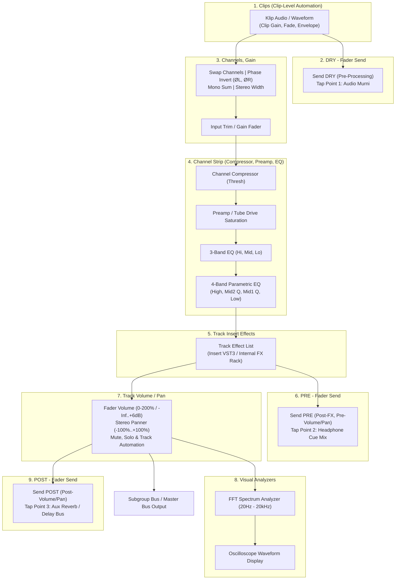

# MusikKu Studio — Audio Engine Technical Specification

Dokumen ini mendefinisikan arsitektur audio berlatensi rendah, algoritma penjadwalan (*scheduling*), perutean sinyal (*routing graph*), sintesis instrumen virtual, efek internal, dan perekaman multitrack pada **MusikKu Studio Audio Engine**.

---

## 1. Waktu Musikal, Jam Audio & Lookahead Scheduler

### 1.1 Representasi Waktu Ganda
1. **Waktu Musikal (Beats & Ticks)**:
   - Satuan dasar: **Beats** (1 Quarter Note = 1.0 Beat).
   - Resolusi sub-beat: **960 Ticks per Beat** (Standar PPQ).
   - Posisi musikal: $\text{Bar} : \text{Beat} : \text{16th} : \text{Tick}$.
   - Hubungan dengan waktu absolut:
     $$\Delta t_{\text{detik}} = \frac{\Delta \text{beats}}{\text{BPM}} \times 60$$

2. **Waktu Riil Audio Hardware (`currentTime`)**:
   - Dihitung oleh hardware audio clock dengan presisi *double float* dalam detik.
   - Pergerakan playhead UI (`requestAnimationFrame`) disinkronkan secara terpisah dari audio clock untuk mencegah audio stutter akibat frame drop.

### 1.2 Algoritma Lookahead Scheduler
Penjadwalan event audio (notasi MIDI, audio chunk, metronom click) **tidak pernah** bergantung langsung pada `setTimeout` saat event dieksekusi:
- Interval timer berkala berjalan setiap **25 ms**.
- Pada setiap iterasi, scheduler memeriksa event yang berada dalam jendela waktu masa depan:
  $$\text{Lookahead Window} = \text{currentTime} + 0.150\text{ detik (150 ms)}$$
- Node audio dijadwalkan menggunakan timestamp presisi tinggi:
  `sourceNode.start(audioContext.currentTime + deltaSeconds)`
- Ini menjamin latensi rendering UI, garbage collection, atau pergeseran tab latar belakang tidak menyebabkan jitter atau suara terputus.

---

## 2. Graf Perutean & Alur Sinyal Audio (Audio Signal Flow - Standar Mixcraft 10)

MusikKu Studio mengimplementasikan topologi pemrosesan sinyal audio 9-tahap yang selaras dengan arsitektur standar **Acoustica Mixcraft**:

### 2.1 Perincian 9 Tahapan Alur Sinyal Audio

1. **1. Clips (with clip-level automation)**:
   - Sinyal audio berasal dari klip di timeline (rekaman vokal, sampel audio, atau hasil sintesis virtual instrument).
   - Memproses automasi tingkat klip (*clip-level automation*): offset gain klip, envelope volume independen, curve fade-in dan fade-out, serta pitch shifting non-destruktif sebelum sinyal masuk ke rantai track.

2. **2. DRY - Fader Send (Tap Point 1)**:
   - Titik pencabangan sinyal paling awal yang mengambil audio mentah langsung dari klip.
   - **Karakteristik**: Bebas dari pengaruh pemrosesan kanal, EQ, saturasi, efek insert, maupun volume fader.
   - **Tujuan**: Ideal untuk pengiriman sinyal mentah ke analyzer eksternal, re-amping murni, atau sidechain kompresor independen. Dilengkapi kontrol send knob, arm switch, lock, dan pemilih bus tujuan.

3. **3. Channels, Gain (Utilitas Kanal & Input Trim)**:
   - **Swap Channels**: Menukar saluran audio kiri (L) dan kanan (R).
   - **Phase Invert (`ØL`, `ØR`)**: Pembalik polaritas fasa 180° independen untuk saluran kiri dan kanan, krusial untuk mengatasi pembatalan fasa (*phase cancellation*) pada rekaman multi-mikrofon (misal drum snare atas/bawah, overheads, gitar akustik stereo).
   - **Mono**: Menjumlahkan stereo menjadi mono terpusat $(L + R)/2$.
   - **Stereo Width**: Mengatur lebar panorama stereo (0% = mono penuh, 100% = stereo normal, hingga 200% = pelebaran Mid/Side stereo).
   - **Input Gain**: Fader trim level masukan sebelum sinyal mengenai prosesor dinamika atau saturasi (*gain staging*).

4. **4. Channel Strip (Compressor, Preamp, 3-Band EQ, Parametric EQ)**:
   - **Compressor**: Kontrol dinamika terintegrasi dengan tombol power bypass dan knob `Thresh` (threshold).
   - **Drive (Preamp)**: Saturasi analog hangat ala tabung (*tube saturation*) dengan tombol power dan knob `Drive`.
   - **3-Band EQ**: Penyetelan tonal cepat dengan kontrol `Hi`, `Mid`, dan `Lo`.
   - **Parametric EQ**: Equalizer 4-band bedah presisi dengan tombol power:
     - *High*: Gain dan frekuensi (1.5 kHz – 16 kHz), high-shelf atau bell.
     - *Mid 2*: Gain, frekuensi (0.5 kHz – 7 kHz), dan knob resonansi bandwidth `Q2`.
     - *Mid 1*: Gain, frekuensi (0.2 kHz – 2.5 kHz), dan knob resonansi bandwidth `Q1`.
     - *Low*: Gain dan frekuensi (30 Hz – 450 Hz), low-shelf atau bell.

5. **5. Track Insert Effects (Rak Efek Insert)**:
   - Rantai efek seri yang menampung plugin VST3 atau efek internal studio (`Track Effect List`).
   - Setiap slot efek mendukung tombol daya aktif/bypass, pemilihan preset, perutean MIDI, dan penataan urutan pemrosesan.

6. **6. PRE - Fader Send (Tap Point 2)**:
   - Titik pencabangan yang mengambil sinyal **setelah** seluruh pemrosesan Channel Strip dan Insert Effects, namun **sebelum** fader Volume dan Pan track.
   - **Karakteristik**: Mempertahankan karakter warna suara dari EQ, kompresor, dan efek insert, namun nilainya konstan dan kebal terhadap perubahan posisi fader volume track.
   - **Tujuan**: Sangat esensial untuk **Headphone Cue Mix** (monitor musisi di ruang rekaman) agar level di headphone musisi tidak mendadak naik/turun saat mixing engineer mengatur fader di ruang kontrol studio.

7. **7. Track Volume / Pan**:
   - **Volume Fader**: Slider pengatur level linear (0% s.d. 200% / -Inf dB s.d. +6 dB) dengan meter level terintegrasi.
   - **Pan Slider**: Penempatan panorama stereo (-100% L s.d. +100% R).
   - **Mute & Solo**: Mematikan sinyal atau mengisolasi playback track.
   - **Track Automation**: Penerapan kurva automasi fader volume dan panning secara real-time.

8. **8. Visual Analyzers (FFT Spectrum Analyzer & Oscilloscope)**:
   - Alat pemantauan visual sinyal pasca-fader:
     - **FFT Spectrum Analyzer**: Menghitung Fast Fourier Transform secara real-time (256/2048 bins) untuk menampilkan kurva respon frekuensi audio (20 Hz – 20.000 Hz).
     - **Oscilloscope**: Menampilkan bentuk gelombang time-domain (amplitudo vs waktu) secara dinamis.

9. **9. POST - Fader Send (Tap Point 3)**:
   - Titik pencabangan standar pasca-fader yang mengambil sinyal **setelah** Track Volume, Pan, Mute, dan Automasi.
   - **Karakteristik**: Mengikuti pergerakan fader volume secara proporsional. Jika fader diturunkan, level send ikut menurun.
   - **Tujuan**: Standar untuk **Aux Reverb & Delay Bus**, menjaga perbandingan sinyal basah (*wet*) dan kering (*dry*) tetap seimbang secara alami saat track di-fader.

---

### 2.2 Tabel Perbandingan Tiga Titik Fader Send (Send Tap Points)

| Fitur / Parameter | 1. DRY - Fader Send | 2. PRE - Fader Send | 3. POST - Fader Send |
| :--- | :--- | :--- | :--- |
| **Lokasi Tap** | Tepat setelah klip audio murni | Setelah Insert Effects & Channel Strip | Setelah Volume, Pan, Mute, & Automasi |
| **Pengaruh Channel EQ / Comp** | Tidak terpengaruh (Murni) | **Terpengaruh** | **Terpengaruh** |
| **Pengaruh Insert Effects** | Tidak terpengaruh (Murni) | **Terpengaruh** | **Terpengaruh** |
| **Pengaruh Track Volume Fader** | Kebal (Tidak terpengaruh) | **Kebal (Tidak terpengaruh)** | **Terpengaruh proporsional** |
| **Pengaruh Track Mute** | Tidak terpengaruh | Tidak terpengaruh | **Mati saat track di-Mute** |
| **Penggunaan Utama** | Re-amping murni, sidechain eksternal, isolasi | Headphone Cue Mix musisi, monitor panggung | Aux Reverb & Delay return bersama |

---

## 3. Instrumen Virtual Internal

### 3.1 Polyphonic Synthesizer (`src/lib/studio/synth.ts`)
- **Oscillator**: Bentuk gelombang `sine`, `sawtooth`, `square`, dan `triangle`.
- **ADSR Envelope**:
  - *Attack*: Durasi transien awal (0.002 s.d. 2.0 detik, eksponensial).
  - *Decay*: Peluruhan dari puncak ke tingkat sustain (0.01 s.d. 2.0 detik).
  - *Sustain*: Tingkat level amplitudo penahanan (0.0 s.d. 1.0).
  - *Release*: Peluruhan setelah not dilepas (0.01 s.d. 4.0 detik).
- **Resonant Lowpass Filter**: Biquad filter dengan parameter Cutoff Frequency (20–20.000 Hz) dan Resonance Q (0.1–20.0).
- **Presets**: Bass, Lead, Poly Pad, Pluck, dan Electric Keys.

### 3.2 Procedural Drum Synthesizer
- **Kick**: Frekuensi sapuan sinus menurun cepat (150 Hz $\rightarrow$ 35 Hz dalam 60 ms) dengan klik transien awal.
- **Snare**: Kombinasi osilator bodi nada (180 Hz) ditambah white noise yang difilter highpass (1.5 kHz) dengan decay 180 ms.
- **Clap**: Tiga semburan (*bursts*) noise cepat (masing-masing 15 ms) diikuti peluruhan reverb-noise 150 ms.
- **Hi-Hat**: White noise bandpass resonant (8 kHz – 12 kHz) dengan decay sangat pendek (Closed: 40 ms, Open: 300 ms).
- **Percussion / Tom**: Osilator sinus termodulasi pitch dengan resonansi bodi drum akustik.

---

## 4. Efek Internal & Automasi Parameter

### 4.1 Katalog Efek Bawaan (`src/lib/studio/effects.ts`)
1. **3-Band Parametric EQ**:
   - Low Shelf (100 Hz, gain -18 dB s.d. +18 dB).
   - Mid Peaking (1000 Hz, Q = 1.0, gain -18 dB s.d. +18 dB).
   - High Shelf (8000 Hz, gain -18 dB s.d. +18 dB).
2. **Studio Compressor**:
   - Threshold (-60 dB s.d. 0 dB).
   - Ratio (1:1 s.d. 20:1).
   - Attack (1 ms s.d. 500 ms).
   - Release (10 ms s.d. 1000 ms).
3. **Master Brickwall Limiter**:
   - Threshold batas keras (-12 dB s.d. 0 dB, default -0.3 dBFS).
   - Knee = 0, rasio = 20:1, attack ultra-cepat (< 1 ms).
4. **Stereo Convolution / Synthetic Reverb**:
   - Impulse response stereo acak dengan kurva peluruhan eksponensial $e^{-3t/\tau}$.
   - Kontrol wet/dry mix ratio (0% s.d. 100%).
5. **Stereo Feedback Delay**:
   - Delay line dengan feedback loop bergain terkalibrasi (< 0.85 untuk kestabilan).
6. **Noise Gate & Multi-mode Filter**:
   - Pilihan filter: Lowpass, Highpass, Bandpass, Notch.

### 4.2 Automasi Terjadwal
- Titik automasi (`AutomationPoint: { beat, value, curve }`) dieksekusi dengan penjadwalan audio clock:
  `audioParam.linearRampToValueAtTime(targetVal, eventTimeSec)`
- Parameter yang dapat diautomasi: Track Volume, Pan, Filter Cutoff, Filter Resonance, Effect Mix/Send Levels.

---

## 5. Multitrack Recording Pipeline

1. **Seleksi & Izin Perangkat**:
   - `navigator.mediaDevices.enumerateDevices()` mendeteksi seluruh mikrofon dan audio interface yang terpasang.
   - Panggilan `getUserMedia({ audio: { echoCancellation: false, noiseSuppression: false, autoGainControl: false } })` memastikan kualitas audio studio murni tanpa degradasi algoritma konferensi suara.
2. **Count-In & Metronom**:
   - Opsi Count-In 1 birama (4 ketukan) atau 2 birama (8 ketukan) berbunyi sebelum perekaman dimulai.
   - Nada aksen pada ketukan pertama (1600 Hz) dan ketukan reguler (880 Hz).
3. **Perekaman Simultan**:
   - Setiap track dengan `armRecord: true` menerima sinyal stream.
   - Pengambilan byte PCM via `MediaRecorder` atau worklet accumulator.
4. **Finalisasi & Penempatan Klip**:
   - Saat perekaman selesai, buffer didekode menjadi Float32 `AudioBuffer`.
   - Disimpan secara lokal ke IndexedDB dengan ID unik `asset_rec_*`.
   - Klip baru (`StudioClip`) dibuat di timeline tepat pada beat awal perekaman dengan durasi terhitung presisi.

---

## 6. Adapter Multiplatform & Kompatibilitas Sistem

1. **Web Audio Adapter** (`src/lib/studio/adapters/web-adapter.ts`):
   - Sepenuhnya berbasis standar W3C Web Audio API & MediaDevices.
   - Mendukung browser modern (Chrome, Firefox, Safari, Edge).
2. **Android Native Adapter** (`src/lib/studio/adapters/android-adapter.ts`):
   - Berjalan dalam runtime Capacitor Android.
   - Mengakses plugin native Oboe/AAudio C++ bila diinstal, atau secara transparan menggunakan fallback Web Audio WebView dengan performa optimal.
3. **Windows Desktop Adapter** (`src/lib/studio/adapters/windows-adapter.ts`):
   - Berkomunikasi dengan binary Tauri 2 Rust (`src-tauri`).
   - Melakukan pemindaian direktori plugin VST3 Windows.
   - Mengakses telemetri WASAPI Exclusive Mode (latensi ~5.3 ms pada buffer 256 frame).

---

## 7. Offline Rendering & Validasi Ekspor WAV

1. Inisialisasi `OfflineAudioContext(channels = 2, length = sampleRate * duration, sampleRate)`.
2. Replikasi seluruh graph pemrosesan (insersi, fader, automasi, reverb tails).
3. `startRendering()` menghasilkan multi-kanal Float32Array terkuantisasi.
4. `encodeWavBlob()` menyusun berkas linear PCM 16-bit atau 24-bit dengan header RIFF standar (44 bytes).
5. `validateWavBlob()` memverifikasi byte signature `'RIFF'` dan `'WAVE'`, nomor kanal, frekuensi sample, dan konsistensi ukuran sebelum berkas dapat diunduh pengguna.
