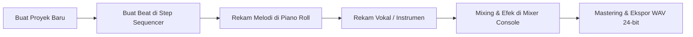
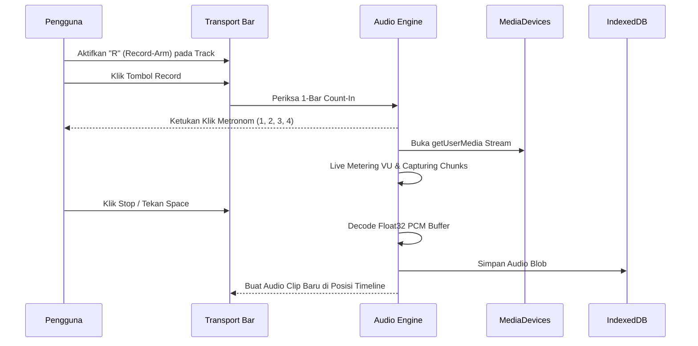

# Panduan Pengguna & Referensi Lengkap MusikKu Studio DAW

**MusikKu Studio** adalah Digital Audio Workstation (DAW) multitrack kelas profesional yang terintegrasi secara mulus di dalam ekosistem MusikKu. Studio ini dirancang untuk produksi musik menyeluruh: mulai dari pembuatan beat (*beat making*), pengubahan sekuens nada MIDI (*MIDI sequencing*), perekaman vokal dan instrumen (*multitrack recording*), penataan aransemen (*timeline arrangement*), pencampuran audio (*mixing & routing*), hingga ekspor akhir berstandar siar (*mastering & WAV export*).

---

## Daftar Isi
1. [Alur Kerja Cepat (Quickstart)](#1-alur-kerja-cepat-quickstart)
2. [Manajemen & Portabilitas Proyek](#2-manajemen--portabilitas-proyek)
3. [Aransemen Timeline & Kontrol Navigasi](#3-aransemen-timeline--kontrol-navigasi)
4. [Beat Machine & Step Sequencer](#4-beat-machine--step-sequencer)
5. [MIDI Piano Roll & Virtual Synthesizer](#5-midi-piano-roll--virtual-synthesizer)
6. [Perekaman Audio Multitrack (Vokal & Instrumen)](#6-perekaman-audio-multitrack-vokal--instrumen)
7. [Mixer Console, Aux Send Buses & Efek Internal](#7-mixer-console-aux-send-buses--efek-internal)
8. [Hosting VST3 & Integrasi Desktop Windows](#8-hosting-vst3--integrasi-desktop-windows)
9. [Mastering & Ekspor Berkas WAV](#9-mastering--ekspor-berkas-wav)
10. [Daftar Pintasan Papan Ketik (Keyboard Shortcuts)](#10-daftar-pintasan-papan-ketik-keyboard-shortcuts)
11. [Pemecahan Masalah & Optimasi Latensi (Troubleshooting)](#11-pemecahan-masalah--optimasi-latensi-troubleshooting)

---

## 1. Alur Kerja Cepat (Quickstart)



1. **Buka Studio**: Akses menu **Studio** pada navigasi atas atau kunjungi URL `/studio`.
2. **Uji Playback**: Klik tombol **Play** (atau tekan `Space`) pada Transport Bar di bagian atas untuk mendengarkan progresi harmoni default.
3. **Mulai dari Beat Drum**: Klik tombol **Step Sequencer** pada Transport Bar. Pilih preset beat seperti *Classic Boombap* atau *Trap 808 Banger*, lalu klik **+ Masukkan ke Timeline**.
4. **Atur Suara Instrumen**: Buka tab **Synthesizer** pada track MIDI untuk memilih preset sound siap pakai (*808 Sub Bass*, *Neon Saw Lead*, atau *Analog Warm Pad*).
5. **Simpan Proyek**: Klik **Proyek** lalu pilih **Simpan ke Browser (IndexedDB)** atau unduh berkas proyek berformat `.json`.

---

## 2. Manajemen & Portabilitas Proyek

Format berkas proyek MusikKu Studio menggunakan skema terbuka JSON versi `1.0.0` yang divalidasi ketat oleh pustaka Zod (`StudioProjectSchema`). Struktur data proyek ini dirancang agar **100% konsisten dan kompatibel lintas platform** (Web, Android, dan Windows).

### A. Penyimpanan Otomatis & IndexedDB
- Setiap rekaman take audio atau perubahan aransemen disimpan secara persisten di penyimpanan IndexedDB lokal browser (`musikku_studio_db`).
- Anda dapat membuat, memuat, dan menghapus proyek tersimpan melalui dialog **Proyek** di Transport Bar.

### B. Ekspor & Impor Berkas Proyek (.json)
- **Ekspor Proyek**: Menyimpan konfigurasi proyek lengkap (tempo, time signature, seluruh track, klip MIDI, parameter instrumen, slot plugin efek, section markers, dan automasi) ke dalam satu berkas `.json`.
- **Impor Proyek**: Muat kembali berkas `.json` proyek dari perangkat manapun. Jika proyek tersebut berisi plugin VST3 Windows dan dibuka di Web/Android, engine akan mengisolasi plugin tersebut dalam status aman (*bypassed/unavailable*) tanpa menghilangkan data parameter atau merusak proyek.

---

## 3. Aransemen Timeline & Kontrol Navigasi

Timeline aransemen terletak di bagian tengah studio, menampilkan lintasan track horizontal dengan sumbu horizontal berbasis ketukan musikal (*musical beats*).

```
+---------------------------------------------------------------------------------------+
| SNAP: [1 Beat (1/4)] | [LOOP: 0 - 8b] | [PUNCH: OFF] | [+ Marker] | [-] [48px] [+]     |
+---------------------------------------------------------------------------------------+
| RULER:  | 1 . . . | 2 . . . | 3 . . . | 4 . . . | 5 . . . | 6 . . . | 7 . . . | 8 . . . |
| MARKER: [ Intro ]                     [ Verse 1 ]                                     |
+---------------------------------------------------------------------------------------+
| Track 1 | [== Klip Akor Piano/Synth ===================]                              |
| Track 2 |           [== Audio Take Rekaman Vokal ======]                              |
+---------------------------------------------------------------------------------------+
```

### A. Kontrol Grid Snap & Zoom
- **SNAP**: Membatasi pergeseran dan penempatan klip ke pecahan ketukan:
  - `1 Beat (1/4)`: Penjajaran per ketukan utuh (rekomendasi komposisi umum).
  - `1/2 Beat (1/8)` & `1/4 Beat (1/16)`: Penjajaran presisi untuk nada ritmis cepat.
  - `Off (Free)`: Pergeseran bebas tanpa penguncian grid.
- **ZOOM**: Tombol `+` dan `-` mengatur rasio tampilan horizontal (24px hingga 128px per beat).

### B. Loop Cycle Mode
- Aktifkan tombol **LOOP** di toolbar timeline untuk memutar ulang bagian tertentu secara berulang tanpa henti.
- Wilayah loop ditandai oleh arsiran ungu transparan di sepanjang timeline.

### C. Section Markers (Penanda Bagian Lagu)
- **Menambah Marker**: Klik tombol **+ Marker** untuk menambahkan penanda struktur lagu (*Intro*, *Verse 1*, *Chorus*, *Bridge*, *Drop*, *Outro*) atau nama custom pada posisi playhead saat ini.
- **Navigasi Cepat**: Klik badge penanda pada sub-lane ruler untuk langsung melompatkan playhead ke bagian lagu tersebut.
- **Hapus Marker**: Arahkan kursor ke badge marker dan klik tombol silang kecil `×`.
- **Double Click Ruler**: Klik dua kali pada area ruler untuk menyisipkan marker baru secara instan pada ketukan yang diklik.

### D. Auto Punch-In / Punch-Out Recording Locators
- Tombol **PUNCH** mengaktifkan mode perekaman terlokalisir (*punch recording*).
- Ditandai dengan badge merah `P-IN` (awal rekaman) dan `P-OUT` (akhir rekaman) pada ruler serta bayangan merah transparan pada lintasan track.

### E. Kontrol Track Header & 6 Tipe Track (Mixcraft Style)
- **6 Tipe Track yang Didukung**:
  1. **Audio Track**: Perekaman mikrofon, impor file audio MP3/WAV/OGG/FLAC, kontrol fader dan pan.
  2. **Instrument / MIDI Track**: Pemutaran not MIDI polifonik, pemilihan preset synth, dan integrasi piano roll.
  3. **Video Track**: Trek video stream tersinkronisasi transport untuk klip musik atau scoring film.
  4. **Video Text Track**: Subtitle lirik dan teks overlay dinamis tersinkronisasi ketukan.
  5. **Submix Track**: Mengelompokkan sejumlah track ke dalam satu sub-grup bus audio.
  6. **Send Track**: Jalur efek aux stereo khusus (Reverb/Delay return).
- **Kustomisasi Track**:
  - **Ikon Track**: Klik ikon track pada header untuk memilih ikon instrumen (*Mic, Piano, Guitar, Drums, Synth, Music, Video, Text, Submix, Send*).
  - **Palet Warna**: Klik lingkaran warna track untuk memilih salah satu dari 14 warna identifikasi.
  - **Tinggi Track Dinamis**: Menu konteks `···` menyediakan preset tinggi *Compact (64px)*, *Normal (96px)*, *Large (144px)*, dan *Extra Large (192px)*.
  - **Pindahkan Track**: Tombol panah atas/bawah pada menu konteks untuk mengatur urutan susunan track.

### F. Track Freeze & Mix to New Audio Track (Bounce)
- **Track Freeze**: Klik tombol kepingan salju (❄) pada menu track untuk membekukan track. Engine akan merender audio track secara offline ke IndexedDB dan mem-bypass instrumen/plugin, menghemat beban CPU secara drastis pada proyek besar.
- **Mix to New Audio Track**: Opsi *Mix to New Audio Track* merender seluruh klip dan efek track tersebut menjadi sebuah Audio Track baru yang siap di-edit lebih lanjut.

---

## 4. Beat Machine & Step Sequencer

Step Sequencer dirancang untuk pembuatan ritme drum cepat dengan umpan balik visual dan audio instan tanpa latensi.

### A. Struktur Grid & Sound Pads
- Mendukung **16 step** (1 bar birama 4/4 pada resolusi 1/16).
- 6 instrumen perkusi prosedural bawaan (berbasis sintesis audio web murni tanpa ketergantungan sampel komersial berhak cipta):
  1. **Kick 808**: Sub-bass berbobot dengan pitch glide eksponensial.
  2. **Snare Studio**: Kombinasi tone body osilator dan noise-burst renyah.
  3. **Hand Clap**: Serangkaian pulsa envelope pendek berlapir filter bandpass.
  4. **Closed Hi-Hat**: Resonansi metalik frekuensi tinggi berdurasi pendek.
  5. **Open Hi-Hat**: Peluruhan desis simbal terbuka panjang.
  6. **Perc / Rim**: Nada perkusi tonal kayu/rimshot beresonansi tinggi.

### B. Swing & Audisi
- **Knob Swing**: Menunda ketukan sixteenth genap (0% hingga 50%) untuk menghasilkan alur ritme funk, hip-hop, atau swing jazz yang organik.
- **Audisi Pad**: Klik ikon speaker pada setiap baris instrumen untuk mendengarkan karakter suaranya kapan saja.

### C. Preset & Penyimpanan Pola (Pattern Storage)
- **Preset Bawaan**: Pilihan instan *Classic Boombap (90 BPM)*, *Trap 808 Banger (140 BPM)*, dan *House 4-on-the-Floor (124 BPM)*.
- **Simpan Pola Saya**: Klik **Simpan Pola**, beri nama pola kreasi Anda, dan pola tersebut akan tersimpan aman ke database IndexedDB browser untuk digunakan di kemudian hari.
- **Transfer ke Timeline**: Klik **+ Masukkan ke Timeline** untuk mengubah pola sekuens menjadi klip MIDI nyata di lintasan track drum timeline.

---

## 5. MIDI Piano Roll & Virtual Synthesizer

Piano Roll memungkinkan aransemen notasi musik polifonik mikro dengan tuts visual 88 nada standar (C1 hingga B7).

```
Tuts  | Grid Nada MIDI (Beats)
------+----------------------------------------------------
C4    |       [======= Notasi Melodi 1 =======]
B3    |
A3    | [=== Notasi 2 ===]             [=== Notasi 3 ===]
```

### A. Fitur Interaktif Piano Roll
- **Menggambar Nada**: Klik pada sel grid kosong untuk menaruh nada baru. Nada akan langsung dibunyikan (*auditioning*) oleh synth engine.
- **Menghapus Nada**: Klik nada yang sudah ada untuk menghapusnya.
- **Bantuan Skala (*Scale Assistance*)**: Aktifkan pemandu skala nada:
  - *Kromatik* (semua nada tuts)
  - *Mayor / Minor* (tangga nada standar barat)
  - *Pentatonis Mayor / Minor* (fondasi solo dan melodi pop/rock)
  - *Blues* (tangga nada dengan blue notes berkarakter)
- **Transposisi Global**: Tombol `-1`, `+1`, `-12` (1 oktaf bawah), dan `+12` (1 oktaf atas) memudahkan eksplorasi kunci lagu tanpa perlu menggambar ulang semua nada.
- **Kuantisasi Otomatis (*Quantize*)**: Meratakan seluruh awal notasi ke grid ketukan musikal terdekat secara matematis presisi.

### B. Virtual Synthesizer (PolySynth) & Sound Presets
Setiap track MIDI dilengkapi mesin sintesis polifonik internal:
- **Pilihan Gelombang Osilator**: *Sine*, *Square*, *Sawtooth*, dan *Triangle*.
- **ADSR Amplitude Envelope**: Pengaturan presisi detik untuk *Attack*, *Decay*, *Sustain* (0–100%), dan *Release*.
- **Low-Pass Filter**: *Cutoff Frequency* (20 Hz – 20.000 Hz) dan *Resonance (Q)* (0.1 – 20) untuk membentuk tone hangat atau tajam menusuk.
- **Pustaka Preset Suara Instan**:
  - `[BASS] 808 Sub Bass`: Bass frekuensi sub murni bertenaga untuk trap, R&B, dan hip-hop.
  - `[BASS] Punchy Saw Bass`: Bass synth agresif dan tegas untuk EDM, synthwave, dan electro.
  - `[LEAD] Neon Saw Lead`: Lead gergaji tajam bergaya cyberpunk & pop modern.
  - `[LEAD] Chiptune Square Lead`: Suara melodi retro bergaya konsol 8-bit arcade klasik.
  - `[PAD] Analog Warm Pad`: Karakter pad lembut atmosferik dengan attack halus untuk latar akor.
  - `[PLUCK] Crystal Pluck`: Suara petikan cerah dengan peluruhan cepat untuk arpeggio dinamis.

---

## 6. Perekaman Audio Multitrack (Vokal & Instrumen)

MusikKu Studio mendukung perekaman multi-track simultan dengan penanganan buffer audio berkualitas tinggi.



### A. Prosedur Perekaman
1. **Pilih Perangkat Input**: Buka dropdown mikrofon di bagian transport untuk memilih mikrofon internal, antarmuka audio USB (*audio interface*), atau mikrofon kondensor.
2. **Arm Track**: Klik tombol **R** (Record-Arm) pada track yang ingin direkam. Anda dapat meng-arm beberapa track audio sekaligus.
3. **Pantau Level Masukan**: Perhatikan VU meter live di transport bar. Jika lampu indikator **CLIP** merah menyala, turunkan gain input pada microphone atau soundcard Anda agar sinyal tidak terdistorsi.
4. **Gunakan Count-In**: Aktifkan **Count-In (1 Bar)** agar metronom memberi aba-aba 4 ketukan sebelum perekaman dimulai.
5. **Selesaikan Rekaman**: Klik tombol **Stop** atau tekan `Space`. Klip audio take akan langsung ditempatkan pada posisi beat awal rekaman.

---

## 7. Mixer Console, Aux Send Buses & Efek Internal

Mixer Console menyediakan kendali pencampuran multi-kanal setara konsol studio analog modern.

### A. Fitur Kanal Mixer
- **Fader Volume & Metering dB**: Rentang gain linear hingga +12 dB dengan skala meter digital responsif.
- **Knob Stereo Panning**: Pemosisian medan suara dari 100% Kiri (`L100`), Tengah (`C`), hingga 100% Kanan (`R100`).
- **Mute & Solo**: Mengisolasi atau membungkam instrumen tertentu secara instan.
- **Aux Sends**: Potensio putar kiriman efek ke **Aux Reverb** dan **Aux Delay** return bus.

### B. Master Bus & Brickwall Peak Limiter
- Kanal Master Bus mengumpulkan seluruh sinyal dari track individu dan aux return.
- Dilengkapi **Brickwall Peak Limiter** bawaan (-0.3 dBFS threshold, 50ms release) dengan indikator LED clipping merah untuk menjamin audio Anda bebas dari distorsi digital yang merusak telinga pendengar.

### C. Katalog 9 Efek Internal Studio

| Efek | ID Plugin | Parameter Utama | Karakter & Kegunaan |
| :--- | :--- | :--- | :--- |
| **3-Band Parametric EQ** | `internal.eq3` | Low Gain, Mid Gain, High Gain (-24 s.d. +24 dB) | Membentuk tonal dasar vokal, bass, dan perkusi |
| **Studio Compressor** | `internal.compressor` | Threshold, Ratio, Attack, Release, Knee | Mengendalikan rentang dinamika dan memadatkan suara |
| **Master Peak Limiter** | `internal.limiter` | Threshold, Release (0.01 - 0.5s) | Mencegah clipping digital pada puncak sinyal |
| **Algorithmic Reverb** | `internal.reverb` | Decay (0.1 - 10s), Mix (Dry/Wet) | Simulasi ruang akustik, studio hall, dan dimensi spasial |
| **Stereo Delay** | `internal.delay` | Time (0.01 - 1.5s), Feedback (0 - 90%), Mix | Efek gema ritmis sinkron dengan ketukan lagu |
| **Noise Gate** | `internal.noisegate` | Threshold (-90 s.d. -10 dB), Attack, Release | Menghilangkan desis latar dan kebocoran mikrofon vokal |
| **Resonant Filter** | `internal.filter` | Mode (Lowpass, Highpass, Bandpass, Notch), Cutoff, Resonance | Filter pembentuk sweep dan efek drop elektronik |
| **Stereo Chorus** | `internal.chorus` | Rate (Hz), Depth, Mix | Efek pengganda suara tebal untuk gitar, vocal backing, dan synth |
| **Utility Gain** | `internal.utility` | Gain (linear/dB), Phase Invert | Utilitas leveling dan pembalik polaritas fase sinyal |

---

## 8. Hosting VST3 & Integrasi Desktop Windows

Pada lingkungan desktop Windows (didukung oleh Tauri 2), MusikKu Studio memiliki kemampuan khusus untuk mendeteksi dan mengoperasikan plugin VST3 native dari produsen pihak ketiga.

### A. Lokasi Pemindaian Standar
Host Windows memindai plugin berekstensi `.vst3` pada direktori:
- `%CommonProgramFiles%\VST3`
- `C:\Program Files\Common Files\VST3`
- `C:\Program Files (x86)\Common Files\VST3`

### B. Fitur VST3 Inspector
- Menampilkan nama instrumen/efek, pembuat (*vendor*), nomor versi, kategori, dan jumlah bus input/output audio.
- Pemindaian dapat disegarkan kapan saja melalui tombol **Pindai Plugin VST3** pada tab VST3 Desktop di dialog inspektor track.
- Driver audio native Windows memanfaatkan **WASAPI Exclusive Mode** dan **ASIO** dengan prioritas Pro Audio thread (`AvSetMmThreadCharacteristics`) yang terisolasi penuh dari proses rendering antarmuka pengguna.

---

## 9. Mastering & Ekspor Berkas WAV

Fitur ekspor studio melakukan proses *offline rendering* cepat berbasis `OfflineAudioContext` multi-channel dengan presisi matematika 32-bit float sebelum dikonversi ke format standar industri linear PCM.

```
+--------------------------------------------------------------+
| EKSPOR MASTER AUDIO PROYEK                                   |
| Sample Rate   : (•) 44.1 kHz (CD Audio)    ( ) 48.0 kHz (Pro)|
| Bit Depth     : (•) 16-bit PCM             ( ) 24-bit PCM    |
| Cakupan       : (•) Seluruh Proyek         ( ) Rentang Loop  |
| Normalisasi   : [✓] Normalisasi Puncak Aman (-0.1 dBFS)      |
|                                                              |
| [ Batal ]                             [ Render & Unduh WAV ] |
+--------------------------------------------------------------+
```

### A. Pilihan Ekspor
- **Bit Depth**:
  - `16-bit PCM`: Standar distribusi CD, streaming web, dan pemutar musik portabel.
  - `24-bit PCM`: Standar studio audio beresolusi tinggi (*audiophile* / *pre-mastering delivery*).
- **Sample Rate**: Pilihan fleksibel antara `44100 Hz` dan `48000 Hz`.
- **Cakupan**: Ekspor seluruh lagu atau hanya rentang loop yang sedang dianalisis.
- **Reverb & Delay Tail Parity**: Ekspor secara otomatis menambahkan ekor peluruhan audio (1.5 detik) di akhir lagu agar gema reverb dan delay tidak terpotong mendadak.
- **Normalisasi Puncak**: Mengukur sample absolut tertinggi dan menaikkan gain audio ke batas optimal `-0.1 dBFS` secara merata tanpa menimbulkan distorsi.

---

## 10. Daftar Pintasan Papan Ketik (Keyboard Shortcuts)

Gunakan pintasan papan ketik berikut untuk mempercepat alur kerja produksi musik Anda:

| Tombol / Kombinasi | Aksi / Perintah | Konteks |
| :--- | :--- | :--- |
| `Space` | Mulai / Jeda Playback (*Play / Pause*) | Global |
| `Ctrl + Z` / `Cmd + Z` | Batalkan Aksi (*Undo*) | Global |
| `Ctrl + Y` / `Ctrl + Shift + Z` | Ulangi Aksi (*Redo*) | Global |
| `Ctrl + M` | Mute / Unmute track terpilih (simultan bila multi-seleksi) | Track Header |
| `Ctrl + L` | Solo / Unsolo track terpilih (simultan bila multi-seleksi) | Track Header |
| `Ctrl + R` | Arm / Disarm rekam track terpilih | Track Header |
| `Ctrl + ~` (atau `` ` ``) | Siklus tinggi track (*Small > Normal > Large > Super Big Gulp*) | Track Header |
| `Delete` / `Backspace` | Hapus klip terpilih atau hapus seluruh track terpilih | Timeline / Track |
| `Ctrl + Click` (Track Header) | Multi-seleksi beberapa track sekaligus | Track List |
| `Shift + Click` (Track Header) | Seleksi rentang track (*Range Selection*) | Track List |
| `Shift + Drag Tepi Bawah` | Ubah ukuran tinggi SEMUA track sekaligus (*Resize All*) | Track List |
| `Alt / Shift / Ctrl + Drag Fader` | Penyesuaian presisi tinggi (*Fine Adjustment*) Volume / Pan | Track Header |
| `Ctrl + Click` (Tombol Mute) | Unmute semua track / Mute "solo" track tertentu | Track Header |
| `Ctrl + Click` (Tombol Solo) | Matikan seluruh solo / Solo eksklusif track tertentu | Track Header |
| `Escape` | Tutup Modal Aktif / Piano Roll / Mixer / Dialog | Global |
| `Klik + Drag Klip` | Menggeser posisi ketukan klip | Timeline |
| `Drag Sisi Kanan Klip` | Mengubah panjang durasi klip (*Resize*) | Timeline |
| `Klik Dua Kali Klip MIDI` | Membuka editor MIDI Piano Roll | Timeline |
| `Klik Dua Kali Ruler` | Menambahkan Section Marker pada ketukan mouse | Timeline Ruler |
| `Klik Tuts Piano Roll` | Audisi nada virtual synth secara real-time | Piano Roll |
| `Enter` (pada input nama) | Menyimpan nama track / marker / pola baru | Input Dialogs |

---

## 11. Pemecahan Masalah & Optimasi Latensi (Troubleshooting)

### A. Audio Tidak Bersuara Saat Pertama Kali Dibuka
- Browser modern memberlakukan kebijakan *Autoplay Policy*. AudioContext browser berada dalam status `suspended` sampai ada interaksi klik pertama dari pengguna.
- **Solusi**: Cukup klik sekali di area studio atau tekan tombol **Play** pada Transport Bar untuk mengaktifkan mesin audio.

### B. Latensi Mikrofon Terdengar Terlambat Saat Merekam Vokal
- Jika Anda mendengar gema vokal sendiri di headphone saat merekam (*monitoring latency*):
  - Gunakan headphone kabel, hindari headphone Bluetooth karena Bluetooth memiliki latensi bawaan hardware sekitar 100ms–200ms.
  - Pada Windows desktop, gunakan driver **ASIO** atau **WASAPI Exclusive** melalui runtime desktop untuk latensi sub-10ms.

### C. Lampu Indikator CLIP Menyala Merah di Master Mixer
- Hal ini menandakan sinyal audio dari kombinasi beberapa track melebihi batas 0 dBFS.
- **Solusi**: Turunkan fader volume masing-masing track atau pastikan Master Limiter aktif.

### D. File Proyek Gagal Disimpan di Mode Penyamaran (Incognito)
- Beberapa browser membatasi alokasi penyimpanan kuota IndexedDB pada jendela penyamaran (*incognito / private mode*).
- **Solusi**: Gunakan jendela browser reguler, atau unduh berkas proyek via menu **Proyek > Ekspor JSON** ke folder lokal komputer Anda.

---

## 12. Menambahkan Track & Manajemen Track Tingkat Lanjut (Mixcraft 10 Standard)

MusikKu Studio menyediakan sistem penambahan dan manajemen track standar industri setara **Acoustica Mixcraft 10**:

### A. Metode Penambahan Track
1. **Tombol `+ Track` pada Header Track List**: Mengklik tombol `+` di sebelah kanan judul `TRACKS (n)` membuka menu Track.
2. **Klik di Area Kosong Track List**: Mengklik kiri atau mengklik kanan pada ruang kosong di bawah track yang ada akan langsung membuka menu Track pada koordinat kursor mouse.
3. **Menu Utama Atas (Top Menu)**:
   - Akses **Track > Add Track** untuk menambahkan track baru di bagian paling bawah.
   - Akses **Track > Insert Track** untuk menyisipkan track tepat di atas track yang sedang aktif/dipilih.

### B. Menu Persist Switch (Sakelar Menu Persisten)
- Sakelar geser horizontal berwarna **biru** di pojok kanan atas menu Track berfungsi sebagai **Menu Persist Switch**.
- **Saat Aktif (Enabled)**: Menu tetap terbuka saat beberapa fungsi dan opsi dipilih berturut-turut (misalnya menambah 3 track audio dan mengaktifkan Show Effects On Tracks sekaligus). Untuk menutup menu persisten, cukup klik di mana saja di luar area jendela menu.
- **Saat Nonaktif (Disabled)**: Jendela menu otomatis tertutup segera setelah pengguna memilih satu aksi atau opsi.

### C. 7 Jenis Track yang Didukung
1. **Audio Track**: Track perekaman dan manipulasi berkas audio WAV/MP3/WebM/AAC.
2. **Instrument Track (MIDI)**: Track virtual synth polifonik, piano roll, dan instrumen MIDI.
3. **Video Track**: Track pemutaran klip video tersinkronisasi audio.
4. **Send Track (FX Return)**: Bus aux return untuk efek bersama seperti reverb atau delay.
5. **SubMix Track**: Bus pengelompokan sub-mix untuk drum bus, vocal bus, atau music bus.
6. **Output Track**: Bus saluran output khusus (hardware/virtual routing).
7. **Vocoder Track**: Track sintesis modulasi suara penggabung pembawa (*carrier*) dan modulator ucapan vokal.

### D. Show Effects On Tracks & Tombol Efek Ungu (Purple Effect Button)
- Opsi **Show Effects On Tracks** menampilkan chip efek insert aktif tepat di sebelah kanan kendali track pada setiap Track Header.
- Efek insert baru dapat ditambahkan secara instan dengan mengklik tanda `+` di samping chip efek (misalnya EQ, Compressor, Limiter, Reverb, Delay).
- Mengklik kanan pada tombol efek ungu (**Purple Effect Button**) membuka submenu lengkap:
  1. **Active**: Mengaktifkan atau me-bypass efek tersebut (ditandai ikon centang jika aktif).
  2. **Remove**: Menghapus efek dari rantai insert track.
  3. **Effect List Is Active**: Mengaktifkan atau me-bypass seluruh efek insert pada track tersebut secara serentak.
  4. **Edit Effects List...**: Membuka jendela dialog editor efek untuk penyesuaian parameter mendalam.
  5. **Close All Effect Windows**: Menutup seluruh jendela dialog efek yang sedang terbuka.
  6. **Remove All Effects**: Menghapus seluruh efek insert pada track tersebut.

### E. Performance Panel (Clip Launcher Grid)
- Menampilkan panel performa klip bergaya matriks peluncuran klip langsung di sebelah kanan track list (antara track list dan timeline).
- Mendukung pemutaran klip per-slot, pemicuan scene serentak (*Scene 1–4*), penguncian tempo (*tempo-locked jam mode*), dan tombol *Stop All*.

### F. Show Master Track
- Menampilkan lintasan **Master Track** langsung di dalam daftar track dan timeline aransemen.
- Dilengkapi fader volume master terkalibrasi (-Inf s.d. +6dB), meter level master stereo, slider pan master, indikator proteksi Brickwall Limiter (-0.3 dB), serta slot efek master inline.

---

## 13. Audio Track & Audio Track Header (Acoustica Mixcraft 10 Standard)

Audio Track digunakan untuk merekam sinyal vokal, instrumen akustik/elektrik, dan memutar klip audio (WAV, MP3, FLAC, OGG). Header Audio Track dirancang secara teliti mengikuti standar operasional **Acoustica Mixcraft 10**:

```
+---+-----------------------------+-----+
| #1| [Audio] Lead Vocal U87      | [^] | (Header Atas: Nomor Track, Tipe, Nama, Upload, FX, Opsi)
|   | [Img] Vocalist (Custom)     |     | (Track Image Thumbnail)
+---+-----------------------------+-----+
| [M] [S] [R|v] [fx] [~] [Vol] [Fork]   | (Kendali: Mute, Solo, Arm+Menu, FX, Automasi, Monitor, Tuner)
+---------------------------------------+
| [Pan: C] [====== 100% (0.0 dB) =====] | (Fader Pan + Level Fader Terintegrasi Level Meter 0%-200%)
|         ATAU [E2 (6th)  [ | ]  IN TUNE] | (Transformasi Display Guitar Tuner saat aktif)
+---------------------------------------+
```

### A. Track Number (Nomor Urut Konstan)
- Semua track diberi nomor urut mulai dari **`#1`** pada track paling atas, dan bertambah ke bawah (`#2`, `#3`, dst.).
- **Aturan Konstan**: Penomoran track bersifat invarian dan dinamis terhadap pergeseran urutan track — track di paling atas selalu `#1`, sehingga jika Track `#5` digeser ke paling atas, nomornya otomatis menjadi `#1`.

### B. Track Name (Nama Track)
- Nama bawaan audio track adalah `Audio Track 1`, `Audio Track 2`, dst.
- Dapat diganti kapan saja dengan **double-click** pada nama track, mengetik nama baru, dan menekan tombol **Enter/Return** atau mengklik di luar area input.

### C. Pan Control
- Kontrol pan berupa slider horizontal kecil di sebelah kiri kontrol volume track.
- Rentang pan dari **100% Left (L100)** hingga **100% Right (R100)**, default di posisi tengah (**Center / C**).
- **Fine Adjustment**: Tahan tombol `[ALT]`, `[SHIFT]`, atau `[CTRL]` saat menggeser slider pan untuk penyesuaian ultra-presisi (10x lebih halus). Double-click mereset pan ke Center.
- **Set Exact Value**: Klik kanan track lalu pilih **Properties > Set Pan (Set Exact Value...)** untuk memasukkan nilai pasti seperti `C`, `L50`, atau `R75`.

### D. Level Control & Integrated Level Meter
- Slider horizontal volume dengan built-in level meter terintegrasi. Rentang volume dari **0% s.d. 200% (-Inf dB s.d. +6 dB)**, dengan garis acuan Unity Gain pada **100% (0 dB)**.
- **Output vs Input Meter**:
  - Pada mode pemutaran standar, meter menampilkan tingkat sinyal keluaran (*output level meter*).
  - Saat track dalam mode Record Arm (tombol `R` merah menyala), meter otomatis berfungsi sebagai **Input Level Meter**.
- **Fine Adjustment**: Tahan `[ALT]`, `[SHIFT]`, atau `[CTRL]` saat dragging untuk pengaturan desibel presisi tinggi. Double-click mereset volume ke 100% (0 dB).
- **Set Exact Value**: Klik kanan track lalu pilih **Properties > Set Volume (Set Exact Value...)** untuk memasukkan persentase (e.g. `100%`, `125%`) atau nilai desibel (e.g. `0 dB`, `-3.5 dB`).

### E. Insert Effects Slots & Power Switch
- Slot insert effects inline ditampilkan tepat di bawah kendali track saat *Show Effects On Tracks* aktif.
- **Power Switch**: Setiap tombol efek ungu (*purple effect button*) dilengkapi sakelar daya (**Power switch**) di sisi kiri tombol. Mengklik ikon Power mengaktifkan atau mem-bypass efek tanpa perlu membuka jendela dialog efek.
- **Tombol Tambah `+`**: Menambahkan insert effect secara instan dari menu cepat (EQ, Compressor, Limiter, Reverb, Delay).
- **Submenu Klik Kanan Efek Ungu**:
  1. *Active*: Mengaktifkan/mematikan efek tertentu.
  2. *Remove*: Menghapus efek dari rantai insert.
  3. *Effect List Is Active*: Menghidupkan/mematikan semua efek insert di track tersebut serentak.
  4. *Edit Effects List...*: Membuka jendela dialog efek lengkap.
  5. *Close All Effect Windows*: Menutup semua jendela efek yang terbuka.
  6. *Remove All Effects*: Menghapus semua efek di track tersebut.
- **Tepi Kanan Track Header**: Arahkan kursor mouse ke tepi kanan track header (kursor berubah menjadi panah horizontal ganda) atau klik untuk menampilkan/menyembunyikan baris slot efek insert.

### F. Arm Button & Audio Inputs Menu (Panah Bawah)
- Tombol **`R` (Arm Record)**: Mengklik tombol `R` menyiapkan track untuk merekam (berubah menjadi merah terang berdenyut).
- **Auto-Arm**: Jika belum ada track yang di-arm, track yang sedang dipilih akan otomatis di-arm saat tombol Record transport ditekan.
- **Audio Inputs Menu (Panah Bawah)**:
  1. **Menu Persist Switch**: Sakelar geser horizontal berwarna biru di kanan atas menu. Saat aktif, menu tetap terbuka saat memilih banyak parameter berturut-turut. Saat nonaktif, menu otomatis tertutup setelah satu pilihan dilakukan.
  2. **Audio Device Selection**: Memilih perangkat hardware antarmuka audio (Default Audio, Internal Mic, USB Interface, Loopback).
  3. **Inputs Select**:
     - *Stereo*: Merekam sinyal stereo (Kanal 1 & 2).
     - *Mono Left*: Merekam kanal input kiri / mikrofon saja (hemat ruang disk).
     - *Mono Right*: Merekam kanal input kanan / instrumen line saja.
  4. **Recording Mode**:
     - **Takes**: Merekam pengambilan rekaman alternatif (*takes lanes*) yang ditumpuk rapi untuk kemudahan comping.
     - **Overdub**: Merekam bertumpuk (*sound-on-sound*) di atas audio yang sudah ada.
     - **Replace**: Menimpa klip audio pada posisi rentang waktu perekaman.
  5. **Monitor Track**: Mengaktifkan pemantauan audio langsung (*Software Monitoring*).
  6. **Guitar Tuner**: Mengaktifkan tuner instrumen bawaan track.
  7. **Arm For Performance Panel**: Menyiapkan slot Performance Panel untuk perekaman langsung (bukan timeline grid utama).
  8. **Arm Track For Recording**: Mengaktifkan/menonaktifkan status arm track.

### G. FX List (Tombol `fx`)
- Tombol ungu berlabel **`fx`** pada header track membuka jendela Effect List Window untuk memilih plugin efek VST dan preset suara.

### H. Open Automation Lane (Ikon Garis Gelombang `~`)
- Tombol dengan ikon garis gelombang (*squiggly line icon*) membuka sub-lane automasi track langsung di bawah track utama pada timeline aransemen (default ke *Track Volume Automation*).

### I. Solo (Warna Biru Mixcraft 10 & Pintasan)
- Mengklik tombol **`S`** mengisolasi pemutaran audio track tersebut.
- Tombol Solo berubah menjadi **biru cerah (`bg-blue-600`)** dan seluruh track non-solo berubah menjadi abu-abu dengan garis-garis diagonal (*repeating diagonal lines*).
- **Pintasan Keyboard**: `[Ctrl]+L` untuk solo track yang sedang dipilih, atau klik kanan > **Properties > Solo**.
- **[Ctrl] + Click Solo Shortcut**:
  - Jika banyak track yang di-solo, `[Ctrl]+Click` pada track non-solo akan mematikan solo di track lain dan hanya men-solo track yang diklik.
  - `[Ctrl]+Click` pada tombol solo track yang sedang aktif akan mematikan semua solo di seluruh proyek (*un-solo all*).

### J. Mute (Warna Biru Mixcraft 10 & Pintasan)
- Mengklik tombol **`M`** membisukan track sementara.
- Tombol Mute berubah menjadi **biru cerah (`bg-blue-600`)** dan semua klip pada track tersebut berubah menjadi abu-abu bergaris diagonal.
- **Pintasan Keyboard**: `[Ctrl]+M`, atau klik kanan > **Properties > Mute**.
- **[Ctrl] + Click Mute Shortcut**:
  - Jika banyak track yang di-mute, `[Ctrl]+Click` pada track yang tidak di-mute akan meng-unmute yang lain dan me-mute track yang diklik (semacam mute "solo").
  - `[Ctrl]+Click` pada tombol mute track yang sedang aktif akan meng-unmute semua track di proyek (*un-mute all*).

### K. Software Monitoring (Ikon Speaker)
- Tombol langsung berikon **Speaker** pada header track audio mengaktifkan *Software Monitoring*.
- Memungkinkan penampil/vokalis mendengarkan sinyal input mikrofon mereka secara live yang telah bercampur dengan musik proyek saat merekam.

### L. Built-in Guitar Tuner (Ikon Garpu Tala)
- Setiap audio track dilengkapi tuner monophonik bawaan untuk gitar, bass, biola, maupun synth analog.
- Mengklik tombol **Tuning Fork (Garpu Tala)** mengubah ikon menjadi biru dan **mengubah slider volume/level meter menjadi Tampilan Tuner**:
  - Menampilkan not musikal terdekat (senar standar: `E2`, `A2`, `D3`, `G3`, `B3`, `E4`).
  - Menampilkan skala deviasi cent dari `-50c` hingga `+50c`.
  - **In-Tune Cursor**: Saat nada tepat setem (*in tune* / deviasi mendekati 0), kursor setem muncul tepat di tengah dan berpendar terang dalam **warna putih (`bg-white shadow-[0_0_12px_#ffffff]`)** dengan lencana `✓ IN TUNE`.
  - Mengklik tampilan tuner dapat mengganti target senar, dan mengklik kembali ikon Garpu Tala atau klik kanan akan mengembalikan tampilan ke slider volume & meter biasa.

### M. Track Image & Artwork
- Setiap track dapat memiliki gambar thumbnail sendiri di bawah nama track untuk personalisasi dan organisasi visual.
- Double-click pada thumbnail gambar track membuka jendela **Choose Track Appearance**:
  - **Mixcraft Included Image Library**: Koleksi ikon instrumen preset (Vocal, Acoustic Guitar, Electric Guitar, Bass, Drums, Grand Piano, Synth Keys, Strings, Brass Horns, FX).
  - **Add My Own Image File...**: Pengguna dapat mengunggah berkas gambar kustom (*JPG, BMP, PNG, GIF*).
- Thumbnail gambar akan ditampilkan dengan elegan di bawah nama track pada ukuran track normal dan besar.

### N. Track Color
- Warna track dapat disetel melalui tombol warna vertikal di paling kiri track, klik kanan > **Properties > Track Color**, atau memilih dari 14 palet warna curated HSL.
- Mengubah warna track otomatis menyelaraskan warna aksen header dan seluruh klip di lintasan timeline track tersebut.

---

## 14. RECORDING AUDIO TRACKS & LANES SYSTEM (Acoustica Mixcraft 10 Compatible)

MusikKu Studio menyediakan alur kerja perekaman audio multitrack komprehensif berstandar DAW profesional Acoustica Mixcraft 10, mencakup *record arming*, deteksi tipe *audio driver*, *multitrack routing*, *metronome & count-in*, *software monitoring*, serta *Lanes comping system*.

### A. Record Arming
- **Definisi**: Menyiapkan lintasan track untuk merekam sinyal masukan dari antarmuka audio (audio interface) atau mikrofon.
- **Visual State**:
  - Mengklik tombol **Arm** mengubah warna tombol menjadi **merah menyala (`bg-red-600 shadow-[0_0_12px_#ef4444]`)** menandakan track siap merekam.
  - Sinyal input meter tetap aktif bergerak membaca level audio secara *real-time* baik saat track dalam status armed maupun disarmed.
- **Pintasan Keyboard**: Tekan **[CTRL]+B** pada keyboard untuk mengaktifkan / menonaktifkan Record Arm pada track yang sedang dipilih.

### B. Perilaku Fader Volume Sesuai Audio Driver
Perilaku fader volume track saat status armed bergantung secara cerdas pada driver audio yang aktif (dipilih melalui menu driver di Transport Bar):
1. **Core Audio / WaveRT / Wave Driver**:
   - Fader volume track berubah menjadi **slider pengatur level rekaman berwarna MERAH** (`accent-red-500`).
   - Dilengkapi meter VU 3-zona interaktif:
     - **Hijau (0% – 70%)**: Sinyal masukan aman.
     - **Kuning (70% – 90%)**: Level rekaman optimal & ideal (area kerja *nominal* yang disarankan).
     - **Merah (90% – 100%)**: Peringatan batas *peak* / kliping audio. Mundurkan slider jika sinyal mencapai area merah.
2. **ASIO Driver**:
   - Fader volume **disembunyikan secara otomatis** saat track di-arm dan digantikan dengan lencana status **`ASIO HW PREAMP`**.
   - *Alasan Teknis*: Driver ASIO audio berlatensi rendah tidak mengizinkan manipulasi software digital gain pada tahap masukan ADC. Level perekaman wajib diatur langsung melalui gain fisik pada hardware soundcard/audio interface atau preamp eksternal.

### C. Pemilihan Input & Perekaman Multitrack Simultan
- Mengklik tanda panah pemilih di samping tombol Arm membuka daftar rute masukan hardware:
  - **Stereo (1+2)**: Merekam sinyal stereo penuh (kiri + kanan).
  - **Mono Left (1)**: Merekam kanal masukan 1/kiri (cocok untuk vokal utama, gitar solo, instrumen mono).
  - **Mono Right (2)**: Merekam kanal masukan 2/kanan (cocok untuk bass, vokal cadangan).
- **Simultaneous Multitrack Recording**: Beberapa track dapat di-arm secara bersamaan dengan kanal masukan berbeda (misal Track 1 merekam ADAT 1 mono vokal, Track 2 merekam ADAT 2 mono gitar elektrik) untuk merekam penampilan live seluruh band secara sinkron ke dalam track terpisah.

### D. Metronome & Count-In Dialog
Mengklik tombol metronome pada transport bar membuka jendela **Metronome Settings**:
- **Recording**: Mengaktifkan ketukan klik metronome selama proses perekaman berlangsung.
- **Playback**: Mengaktifkan ketukan klik metronome saat pemutaran playback biasa.
- **Recording Count-In Measures**: Memberikan ketukan hitungan awal (1 atau 2 birama) sebelum rekaman benar-benar dimulai, sehingga musisi dapat bersiap mengikuti tempo.

### E. Dual-Arrow Tempo (BPM) Widget
Kontrol tempo pada transport bar mendukung penyesuaian multi-presisi:
- **Panah Kiri (Left Arrows)**: Menambah atau mengurangi tempo dalam kelipatan bulat **±1 BPM**.
- **Panah Kanan (Right Arrows)**: Menambah atau mengurangi tempo dalam kelipatan halus **±0.1 BPM**.
- **Display Numerik**: Mengklik langsung angka tempo memungkinkan pengisian angka tempo desimal secara eksak.

### F. Software Monitoring & Efek Saat Rekaman
- Mengklik ikon **Speaker Monitoring** mengubah warnanya menjadi **biru terang (`bg-blue-600 shadow-[0_0_10px_#2563eb]`)**, memungkinkan pengguna mendengar sinyal masukan instrumen atau vokal secara *real-time* melalui headphone.
- **Hearing Effects During Recording**: Efek insert track (seperti Reverb, Delay, atau Amp Simulator) terdengar langsung saat software monitoring aktif, namun file audio yang direkam ke dalam klip tetap berformat **kering (*dry recording*)**, memberikan kebebasan mixing maksimal pasca-rekaman.
- Disarankan menggunakan headphone bertipe *closed-ear* untuk mencegah kebocoran bunyi klik metronome ke dalam mikrofon akustik.

### G. Lanes System & Comping Takes
Lanes adalah sub-lintasan horizontal dalam satu channel track yang memfasilitasi rekaman berulang tanpa menimpa (*takes & overdubs*).
1. **Mode Perekaman (Recording Modes)**:
   - **Takes Mode (Default)**: Dirancang untuk merekam beberapa *pass* penampilan secara *loop*. Setiap putaran loop secara otomatis menghasilkan Lane baru. Klip dari take sebelumnya **otomatis di-mute** (`muted: true`) dengan aksen garis diagonal arsir dan tanda `MUTED`.
   - **Overdub Mode**: Setiap rekaman baru diletakkan pada lane baru, namun klip dari rekaman terdahulu **tetap aktif dan terdengar** (sangat ideal untuk menumpuk harmoni vokal atau instrumen berlapis).
   - **Replace Mode**: Rekaman baru langsung menggantikan klip audio lama pada rentang waktu tersebut tanpa membuat lane baru.
2. **Manajemen Lanes**:
   - **Tambah Lane**: Klik kanan grid klip > `Lanes > Add` atau tekan shortcut **[ALT]+L**.
   - **Hapus Lane Terbawah**: Klik kanan grid klip > `Lanes > Delete`.
   - **Hapus Lane Kosong**: Klik kanan grid klip > `Lanes > Delete Empty Lanes` atau tekan shortcut **[ALT]+K**.
   - **Mute / Unmute Lane**: Klik kanan lintasan lane > `Lanes > Mute All` atau `Lanes > Unmute All` untuk mengisolasi klip yang diinginkan.
3. **Denny Laine Trivia**:
   - Menu konteks Lanes menyertakan catatan sejarah musik: *"Denny Laine bukan hanya rhythm guitarist & bassist Wings di era 70-an, ia juga merupakan pentolan The Moody Blues era 60-an yang menyanyikan lagu hit 'Go Now' sebelum era cosmic rock mereka."*

---

## 15. TRACK RIGHT-CLICK COMMANDS - AUDIO TRACK (Spesifikasi Mixcraft 10)

Mengklik kanan pada header audio track membuka menu konteks interaktif desktop DAW lengkap dengan sub-menu hirarkis dan dukungan *boundary-aware positioning*:

### A. Insert Track (Sub-menu)
Menyisipkan track baru secara presisi tepat di atas track saat ini (`insertAbove: true`):
- **Audio Track**: Lintasan baru untuk rekaman atau impor klip audio.
- **Instrument Track**: Track MIDI sintetis / instrumen virtual.
- **Video Track**: Lintasan pemutaran video latar (maksimal 1 per proyek).
- **Video Text Track**: Lintasan teks lirik dan subtitle video sinkron.
- **SubMix Track**: Bus pengelompokan stem untuk sub-mixing kelompok instrumen.
- **Send Track**: Bus efek aux return dengan perutean send reverb/delay.
- **Output Track**: Master kanal output bus stereo.
- **Vocoder Track**: Track modulasi vokal & synth carrier.

### B. Delete Track
Menghapus track saat ini beserta seluruh klip, automasi, dan rantai efeknya dari proyek.

### C. Color (Palet Warna & Kustom)
Mengubah aksen visual identifikasi track:
- **14 Pilihan Warna Cepat**: Palet warna HSL berkualitas tinggi (*Purple, Cyan, Emerald, Rose, Amber, Blue, Violet, Indigo, Orange, Red, Pink, Lime, Sky, Teal*).
- **Pilih Ikon, Gambar & Warna Kustom...**: Membuka dialog pemilih ikon, gambar cover, dan *color picker* hex lengkap.

### D. Link (Pengelompokan Kontrol Terhubung)
Menghubungkan beberapa track agar kontrol Volume, Pan, Mute, Solo, dan Send bergerak bersamaan:
- **Link Selected Tracks**: Menghubungkan track saat ini dengan track lain yang sedang terpilih (minimal 2 track). Menampilkan ikon rantai unik berwarna (`chain icon`) di header track.
- **Unlink**: Melepaskan hanya track saat ini dari grup link tanpa memutus hubungan track lainnya dalam grup tersebut.
- **Unlink All**: Melepaskan seluruh track dalam grup link saat ini (*"Unlike Fleetwood Mac, you can always break the chain..."*).
- **Select All Linked Tracks**: Memilih serentak semua track yang berada dalam grup link yang sama.
- *Catatan*: Track linking dikesampingkan untuk volume/pan jika kunci automasi aktif untuk parameter tersebut.

### E. Lanes (Manajemen Jalur Take & Comping)
- **Add ([Alt]+L)**: Menambah jalur lane baru di bawah klip track saat ini.
- **Delete**: Menghapus lane terbawah beserta klip di dalamnya.
- **Delete Empty Lanes ([Alt]+K)**: Menghapus semua lane yang tidak memiliki klip audio aktif.
- **Mute All**: Mematikan suara semua lane pada track ini.
- **Unmute All**: Mengaktifkan kembali suara seluruh lane.
- **Select**: Memilih semua klip yang ada di seluruh lane track ini.
- **Denny Laine Trivia**: Catatan sejarah legenda rhythm guitar/bass Wings & The Moody Blues.

### F. FX... & Tampilan Efek
- **FX...**: Membuka jendela dialog *Effects List* untuk track ini (menambahkan VST3, Chorus, Delay, Reverb, EQ, Compressor).
- **Show Effects On Tracks**: Menampilkan atau menyembunyikan tombol efek insert ungu secara global di samping header track list.
- **Show Automation Lane**: Menampilkan atau menyembunyikan kurva automasi volume, pan, dan parameter plugin.

### G. Properties (Properti Track)
- **Mute ([Ctrl]+M)**: Mematikan audio track sementara (tombol Mute menyala biru, klip menjadi abu-abu dengan arsir diagonal).
- **Solo ([Ctrl]+L)**: Mematikan audio seluruh track lain (tombol Solo menyala biru).
- **Set Exact Volume...**: Dialog slider dan input angka desimal presisi untuk volume (0% hingga 200% / -Inf dB hingga +6 dB).
- **Set Exact Pan...**: Dialog slider dan input angka desimal presisi untuk panning (-100% kiri hingga +100% kanan).
- **Height**: Memilih ukuran tinggi track secara instan:
  - **Small**: 64 px
  - **Normal**: 96 px
  - **Large**: 144 px
  - **Extra Large**: 240 px (*Super Big Gulp X-Treme™*)
- **Cycle Track Size ([Ctrl]+~)**: Berganti ukuran track secara berurutan (*Small -> Normal -> Large -> Extra Large -> Small*).
- **Choose Image...**: Memilih gambar sampul ikon track dari pustaka bawaan atau mengunggah gambar kustom (format JPG, PNG, GIF, BMP).

### H. Mix To New Audio Track & Duplicate
- **Mix To New Audio Track**: Mem-bouncing semua klip audio atau instrumen virtual beserta seluruh efek insert menjadi satu klip audio stereo kontinu baru, dan meletakkannya pada audio track baru tepat di bawah track saat ini. Sangat ideal untuk:
  - Menyematkan efek secara permanen saat berbagi file proyek ke komputer lain tanpa plugin yang sama.
  - Pengarsipan jangka panjang (*long-term archiving*) agar proyek tetap dapat diputar tanpa ketergantungan OS atau format plugin usang.
- **Duplicate**: Menggandakan track beserta seluruh klip, automasi, pengaturan volume/pan, dan rantai efeknya dengan ID unik baru.

### I. Freeze / Unfreeze Track
- **Freeze**: Membakar (*burn-in*) efek dan instrumen ke dalam file audio latar belakang pada track yang sama. Seluruh plugin efek dinonaktifkan saat playback untuk membebaskan beban CPU komputer.
- Track yang di-freeze diberi aksen warna biru dengan motif arsir diagonal (*striped pattern*) dan indikator badge `FROZEN`.
- **Unfreeze**: Mengembalikan track ke status standar dengan plugin efek aktif kembali secara utuh dan non-destruktif.

### J. Seleksi & Pengurutan
- **Select All Clips**: Memilih seluruh klip yang ada pada track ini.
- **Select All Linked Tracks**: Memilih semua track yang berada dalam satu grup keterhubungan (*link group*).
- **Pindahkan Ke Atas / Ke Bawah**: Mengatur ulang urutan vertikal track dalam timeline daw.

---

## 16. VIRTUAL INSTRUMENT / MIDI TRACK & HEADER (Spesifikasi Mixcraft 10 & 10.5)

Track Virtual Instrument / MIDI digunakan untuk memuat instrumen VSTi sintetis dan mengontrol instrumen MIDI eksternal. Track ini dapat dimainkan serta direkam menggunakan kontroler keyboard USB/MIDI fisik atau keyboard QWERTY komputer melalui **Musical Typing Keyboard (MTK)**.

Track Virtual Instrument mudah dibedakan dari tipe track lainnya melalui **ikon keyboard** yang berada tepat di samping tombol Mute.

### A. Nomor & Nama Track
1. **Track Number**: Penomoran track bersifat konstan berbasis 1 (`#1`, `#2`, ...), selalu berurutan dari atas ke bawah terlepas dari pergeseran atau pengaturan ulang urutan track.
2. **Track Name**: Nama bawaan mengikuti nama instrumen virtual yang sedang aktif. Pengguna dapat mengubah nama kapan saja dengan melakukan klik ganda, mengetikkan nama baru, lalu menekan tombol **[ENTER]** atau **[RETURN]**.

### B. Pan & Level Control Fader
1. **Pan Control**: Slider horizontal di sebelah kiri fader volume mengatur perataan stereo dari **100% Kiri (L100)** hingga **100% Kanan (R100)**, berposisi default di tengah (**C**). Dapat diatur secara numerik eksak melalui menu `Track > Properties > Set Pan > Set Exact Value...`.
   - *Tip*: Tahan tombol **[ALT]**, **[SHIFT]**, atau **[CTRL]** saat menggeser slider untuk penyesuaian yang lebih halus dan presisi.
2. **Level Control & Meter**: Slider volume horizontal terintegrasi dengan meter level beresolusi tinggi (rentang 0% hingga 200% / -Inf dB hingga +6 dB).
   - **Mode Pemutaran Normal**: Meter menampilkan level output audio hasil sintesis instrumen.
   - **Mode Record Arm (Tombol R Merah)**: Meter beralih fungsi menjadi **Input Activity & Note Velocity Meter**, memberikan umpan balik visual langsung terhadap ketukan dan dinamika permainan keyboard.
   - Penyesuaian eksak dapat diakses melalui `Track > Properties > Set Volume > Set Exact Value...` atau klik kanan track.

### C. Insert Effects & Handle Tepi Kanan
- **Add / Enable / Disable Effects**: Efek insert dapat ditambahkan langsung dengan mengklik tombol `+`. Setiap efek dilengkapi tombol sakelar daya (*power switch*) di sisi kiri untuk mem-bypass efek tanpa menghapusnya dari rantai sinyal.
- **Toggle Tampilan Efek**: Visibilitas slot efek inline dapat diaktifkan melalui menu `Track > Show Effects On Tracks`, klik kanan header track, atau dengan mendekatkan kursor ke **tepi kanan header track** di mana kursor berubah menjadi panah horizontal ganda `<->` untuk diklik atau ditarik ke kanan.

### D. Instrument Quick Access (Mixcraft 10.5)
- **Tombol Akses Cepat**: Terletak di samping slot efek insert pada baris efek track Virtual Instrument, menampilkan nama instrumen aktif (misal `Synth: Sawtooth` atau nama instrumen VSTi).
- **Power Switch**: Sakelar daya di sisi kiri tombol instrumen memungkinkan pengguna mem-bypass instrumen virtual seketika tanpa membuka window editor.
- **Pemindahan & Penyalinan Instrumen Drag-and-Drop**:
  - Untuk memindahkan instrumen ke track lain: Seret (*drag*) tombol instrumen lalu lepaskan (*drop*) di atas tombol keyboard track tujuan.
  - **Pro Tip**: Tahan tombol **[ALT] + drag** untuk menyalin (*copy*) seluruh preset dan instrumen ke tombol keyboard track tujuan!

### E. Tombol Arm & Menu Masukan MIDI (Panah Bawah)
Mengklik tombol Arm (R) menyiapkan track untuk perekaman (tombol menyala merah terang). Mengklik tanda panah ke bawah di samping tombol Arm membuka menu masukan virtual instrument:
1. **Menu Persist Switch**: Slider horizontal biru di kanan atas menu. Jika aktif, menu tetap terbuka saat memilih beberapa opsi konfigurasi sekaligus hingga pengguna mengklik area luar menu.
2. **MIDI Input Device Selection**: Pemilih perangkat masukan MIDI:
   - *All MIDI Devices* (Default: menerima masukan dari seluruh controller yang tersambung)
   - *Musical Typing Keyboard (MTK / QWERTY)*
   - *USB / MIDI Keyboard Controller*
   - *Drum Pad Controller*
   - *MIDI Guitar Controller*
   - *EWI Wind Controller (Electronic Wind Instrument)*
3. **MIDI Channel**: Tombol pemilihan kanal MIDI dari **All (Omni)** hingga **Kanal 1 – 16**. Pengaturan kanal spesifik sangat berguna saat menggunakan instrumen multi-manual (seperti organ Hammond B-3) atau saat merekam beberapa pemain instrumen secara simultan.
4. **Recording Mode**:
   - **Takes**: Merekam loop take alternate pada sub-lane baru, secara otomatis me-mute take terdahulu.
   - **Overdub**: Menumpuk not MIDI baru ke dalam klip/lane yang ada tanpa mematikan rekaman sebelumnya.
   - **Replace**: Menimpa dan menggantikan not MIDI pada rentang durasi rekaman baru.
5. **Automatic Quantization**: Mengkuantisasi waktu penekanan not secara otomatis saat rekaman masuk (*on the way in*) dengan pilihan resolusi: `Off`, `1/4 Note`, `1/8 Note`, `1/16 Note`, `1/32 Note`, `1/8 Triplet`, dan `1/16 Triplet`.
6. **Snap Notes To Scale**: Menyelaraskan not nada yang masuk secara otomatis ke tangga nada dan kunci yang sedang disetel pada transport bar.
7. **Arm For Performance Panel**: Menyiapkan slot Performance Panel untuk merekam klip pola langsung ke kisi peluncur klip jam-session.
8. **Arm Track For Recording**: Mengaktifkan atau menonaktifkan status kesiapan rekaman track.

### F. FX List & Open Automation Lane
- **Tombol FX (`fx`)**: Membuka jendela *Effects List & Virtual Instruments* untuk memuat preset synthesizer bawaan, efek VST3, dan rantai pemrosesan.
- **Ikon Gelombang Squiggly**: Membuka jalur automasi track (*Automation Lane*) tepat di bawah track utama, dengan default kurva automasi Volume Track.

### G. Solo & Mute (Logika Mixcraft & [Ctrl]+Click)
- **Solo**: Mengisolasi audio track terpilih (tombol menyala biru, track lain berarsir diagonal abu-abu). Shortcut **[CTRL]+L** atau menu Properties.
- **Mute**: Membisukan audio track (tombol menyala biru, seluruh klip berarsir diagonal abu-abu). Shortcut **[CTRL]+M** atau menu Properties.
- **Pintasan [CTRL] + Click**:
  - Pada track yang belum di-solo/mute: Menjadikan track tersebut sebagai satu-satunya yang aktif di-solo atau di-mute.
  - Pada track yang sudah di-solo/mute: Mematikan status solo/mute untuk seluruh track dalam proyek secara bersamaan (*"Multiple tracks cannot be Han Soloed"*).

### H. Track Image & Track Color
- **Track Image**: Thumbnail visual yang terletak di bawah nama track. Pengguna dapat melakukan klik ganda pada thumbnail untuk memilih ikon dari galeri instrumen bawaan (Piano, Guitar, Drums, Synth, Strings, dll.) atau mengunggah berkas gambar kustom (format didukung: JPG, PNG, GIF, BMP).
- **Track Color**: Bar vertikal warna di sisi paling kiri track header dapat diklik langsung untuk membuka palet warna kustom, atau disetel melalui klik kanan > `Color`. Mengubah warna track secara otomatis menyelaraskan warna header dan seluruh klip MIDI di lintasan timeline.

---

## 17. VIDEO AND VIDEO TEXT TRACKS (Spesifikasi Mixcraft 10)

MusikKu Studio mengadopsi fitur pengeditan video bertenaga dari Acoustica Mixcraft yang memungkinkan musisi dan produser:
- **Menambahkan soundtrack musik** ke dalam video film atau konten kreasi.
- **Menambahkan efek suara (foley & sound effects)** tersinkronisasi presisi milidetik.
- **Membuat slideshow** rangkaian gambar diam (*still images*).
- **Menambahkan judul, lirik lagu karaoke, subtitle, atau kredit penutup** ke dalam video.
- **Sinkronisasi video ke audio** dengan akurasi milidetik (*frame-accurate*).
- **Mengekspor proyek** ke video untuk platform daring atau pengarsipan.

### A. Video Track (Trek Video Utama)
Trek video menampung klip video (format MP4, WebM, dll.) dan/atau gambar diam (*still images* seperti JPG, PNG).
- **Batasan Utama**: **Sebuah proyek HANYA DAPAT MEMILIKI SATU TRACK VIDEO.** Jika pengguna mencoba menambahkan track video kedua, sistem DAW akan menolak dengan notifikasi peringatan.
- **Associated Audio Track Otomatis**: Saat file video yang memiliki trek suara diimpor ke dalam proyek:
  1. Klip video dimuat ke dalam Video Track.
  2. Sebuah **Audio Track terkait (*associated audio track*)** secara otomatis dibuat tepat di bawah Video Track dengan klip audio yang diekstrak.
  3. Audio track ini (beserta klip audionya) dapat dihapus kapan saja tanpa mempengaruhi klip pada Video Track.

### B. Video Track Header (Kontrol Header Trek Video)
Trek video memiliki antarmuka header khusus yang diadaptasi dari spesifikasi Mixcraft 10:
1. **Track Number**: Nomor track selalu berurutan berbasis 1 (`#1`, `#2`, ...) dari trek paling atas ke bawah tanpa memandang pemindahan atau penyusunan ulang urutan track.
2. **Track Name**: Nama bawaan adalah **Video Track**, dapat diubah kapan saja dengan klik ganda teks nama lalu menekan tombol **[ENTER]** atau **[RETURN]**.
3. **Show / Hide Video Window (Ikon Roll Film)**:
   - Mengaktifkan atau menyembunyikan jendela pratinjau video mengambang (*floating video preview window*).
   - Dapat diakses dengan shortcut **[Ctrl]+[Alt]+V**.
4. **Show / Hide Video Text Track (+ / - Sign)**:
   - Terletak di baris tengah header track video.
   - **Tanda Plus (+)**: Menambahkan atau menampilkan Video Text Track tepat di bawah Video Track.
   - **Tanda Minus (-)**: Menyembunyikan atau menghapus Video Text Track.
5. **Open Automation Lane (Ikon Squiggly Bergelombang)**:
   - Membuka sub-lane kurva automasi di bawah trek video untuk mengatur automasi Volume Track atau Opasitas Video.
6. **Mute & Solo**:
   - **Mute**: Menyembunyikan output visual video selama pemutaran.
   - **Solo**: Mengisolasi playback audio dan video proyek.
7. **Track Image & Track Color**:
   - Pengaturan gambar sampul personalisasi (*Track Image*) berformat JPG, PNG, GIF, BMP.
   - Bilah warna track di sisi paling kiri (*Track Color bar*) yang dapat diklik langsung untuk memilih warna highlight track dan klip.

### C. Video Text Track (Trek Teks & Lirik Video)
Video Text Track adalah tipe trek video terspesialisasi yang digunakan untuk merancang teks statis, lirik lagu, teks berjalan (*scrolling text*), serta kredit film:
- Trek ini ditempatkan tepat di bawah trek video utama.
- Menampung klip `video-text` yang menyimpan data properti `textOverlay`, posisi ketukan (`startBeat`), serta durasi (`durationBeats`).
- Pada header track, tersedia tombol pintas **[+ Text / Lirik]** untuk menambahkan klip teks lirik atau judul baru ke timeline secara instan.

### D. Floating Video Preview Window (Jendela Pratinjau Video Mengambang)
Jendela pratinjau video mengambang dirancang dengan estetika glassmorphism modern berfitur lengkap:
- **Tampilan SMPTE Timecode**: Format standar penyiaran `HH:MM:SS:FF` pada kecepatan 30 frame per detik, selalu sinkron dengan playhead waktu proyek.
- **Rasio Aspek**: Pilihan cepat antara layar lebar modern **16:9** dan rasio klasik **4:3**.
- **Mode Layar Penuh (Fullscreen)**: Tombol pembesar layar penuh untuk peninjauan sinematik.
- **Pola Siaga Cinema Slate (Standby Pattern)**: Menampilkan bingkai bioskop bergaris dan label standby saat belum ada klip video yang dimuat.
- **Hamparan Teks & Lirik Real-Time**: Teks judul atau lirik dari klip Video Text Track yang aktif di ketukan saat ini secara otomatis dirender sebagai subtitle sinematik di bagian bawah layar video.
- **Impor Berkas Cepat**: Tombol *Import Video / Gambar* yang memfasilitasi pemuatan file video dan otomatisasi pembuatan associated audio track.

---

## 18. ALUR SINYAL AUDIO (Audio Signal Flow - Spesifikasi Mixcraft 10)

Memahami alur sinyal audio (*audio signal flow*) sangat penting untuk memaksimalkan kontrol dinamika, penyeimbangan nada (EQ), penempatan efek insert, serta perutean aux send bus.

Berikut adalah urutan 9 tahapan pemrosesan sinyal dari sumber klip hingga bus keluaran:

### 1. Clips (with clip-level automation)
Titik awal sinyal audio yang bersumber dari klip timeline (audio waveform atau sintesis MIDI). Klip memproses automasi mandiri (*clip-level automation*) mencakup offset gain klip, envelope volume, pitch shift, serta titik fade-in/fade-out sebelum sinyal memasuki rantai pemrosesan track.

### 2. DRY - Fader Send (Tap Point 1)
Titik pencabangan send pertama yang mengambil sinyal **audio murni (*DRY*)** langsung dari klip.
- **Sifat**: Kebal terhadap input gain, phase invert, channel strip EQ/kompresor, efek insert, maupun posisi fader volume track.
- **Penggunaan**: Re-amping instrumen, sidechaining kompresor mandiri, atau analisis sinyal asli tanpa pewarnaan audio apa pun.

### 3. Channels, Gain
Modul utilitas penataan saluran dan input gain:
- **Swap Channels**: Menukar posisi kanal stereo kiri (L) dan kanan (R).
- **Phase Invert (`ØL`, `ØR`)**: Membalik fasa (polaritas 180°) saluran kiri atau kanan secara terpisah guna memperbaiki masalah pembatalan fasa (*phase cancellation*) pada rekaman multi-mikrofon.
- **Mono**: Menjumlahkan sinyal stereo menjadi mono terpusat.
- **Stereo Width**: Mengatur kelebaran ruang stereo (0% mono s.d. 200% Mid/Side expanded stereo).
- **Input Gain**: Fader trim level untuk penyesuaian gain staging sebelum sinyal memasuki kompresor atau saturasi.

### 4. Compressor, Preamp, 3-Band EQ, Parametric EQ
Modul channel strip internal track:
- **Compressor**: Kontrol dinamika dengan tombol power bypass dan knob `Thresh` (threshold).
- **Drive (Preamp)**: Saturasi analog hangat ala tabung (*tube preamp saturation*) dengan knob `Drive`.
- **3-Band EQ**: Penyetelan cepat 3-pita frekuensi (`Hi`, `Mid`, `Lo`).
- **Parametric EQ**: Equalizer parametrik 4-pita presisi tinggi (High shelf/bell, Mid 2 dengan bandwidth `Q2`, Mid 1 dengan bandwidth `Q1`, dan Low shelf/bell).

### 5. Track Insert Effects
Rantai rak efek insert serial (`Track Effect List`):
- Menampung plugin instrumen/efek VST3 atau modul efek bawaan studio.
- Sinyal diproses secara berurutan sesuai susunan slot efek dari atas ke bawah.

### 6. PRE - Fader Send (Tap Point 2)
Titik pencabangan send kedua yang mengambil sinyal **setelah** seluruh efek channel strip dan insert rack, namun **sebelum** fader Volume dan Panning track.
- **Sifat**: Mengikutsertakan warna suara EQ, kompresor, dan plugin insert, namun kebal terhadap naik-turunnya fader volume track.
- **Penggunaan Utama**: **Headphone Cue Mix** (monitor musisi rekaman). Musisi dapat mendengar vokal mereka yang sudah diberi kompresi dan EQ, tanpa terganggu jika juru rekam menaik-turunkan fader volume di ruang kontrol.

### 7. Track Volume / Pan
Pusat kendali fader track:
- **Fader Volume**: Pengatur level (0% s.d. 200% / -Inf dB s.d. +6 dB) dengan meter VU terintegrasi.
- **Pan Slider**: Penempatan panorama stereo (-100% L s.d. +100% R).
- **Mute & Solo**: Pemadaman atau isolasi playback track.
- **Track Volume Automation**: Sub-lane automasi kurva fader volume dan panning dinamis.

### 8. FFT Spectrum Analyzer & Oscilloscope
Alat pemantauan visual pasca-fader:
- **FFT Spectrum Analyzer**: Kurva visual spektrum frekuensi audio real-time (20 Hz – 20.000 Hz).
- **Oscilloscope**: Tampilan bentuk gelombang time-domain interaktif yang memperlihatkan amplitudo vs waktu.

### 9. POST - Fader Send (Tap Point 3)
Titik pencabangan send standar pasca-fader yang mengambil sinyal **setelah** Volume, Pan, Mute, dan Automasi.
- **Sifat**: Level pengiriman send bergerak sebanding dengan posisi fader volume track. Jika track di-mute, send otomatis mati.
- **Penggunaan Utama**: **Aux Reverb & Delay Bus**. Memastikan perbandingan suara basah (*wet*) dan suara kering (*dry*) tetap proporsional dan kohesif saat volume track diubah.

---

*Dokumen ini merupakan bagian dari spesifikasi resmi MusikKu Studio DAW. Untuk perincian teknis mendalam mengenai arsitektur kode dan graf perutean audio, silakan baca [studio-architecture.md](file:///home/miran/projec/musiku/docs/studio-architecture.md) dan [audio-engine.md](file:///home/miran/projec/musiku/docs/audio-engine.md).*


